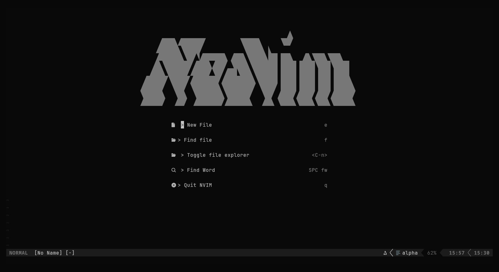
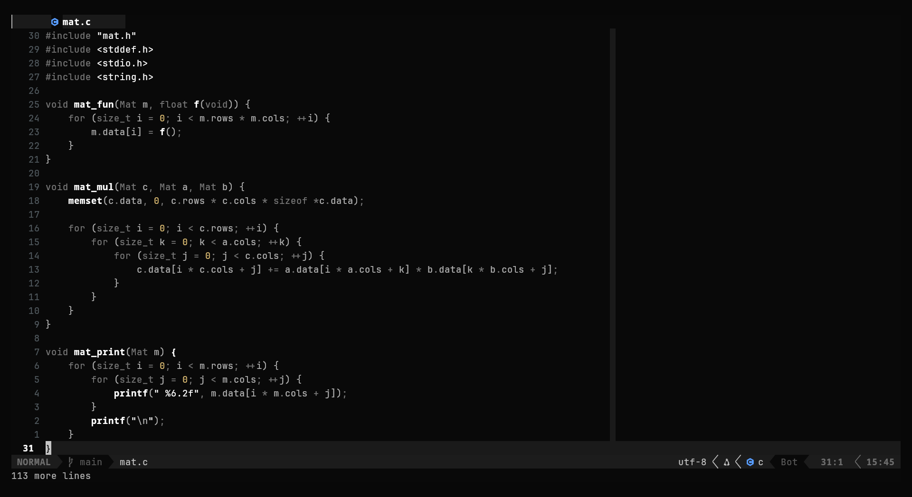

# nvim

My Neovim config, in a single `init.lua` with commented sections and an index at the top of the file, trimmed down to what I actually use: **C, Python and web**.

## Credits

- Base: [SalarAlo/neovim_configuration](https://github.com/SalarAlo/neovim_configuration)
- Ideas and snippets: [CarraraSoftware/config.nvim](https://github.com/CarraraSoftware/config.nvim)

## Showcase

| Start screen | Code editing |
| --- | --- |
|  |  |

## What's in it

- **Plugin manager:** [lazy.nvim](https://github.com/folke/lazy.nvim)
- **Themes:** koda (default, monochrome), plain, catppuccin and gruvbox, with `:Theme`, `:ThemeNext` and `:ThemePrev` (the chosen theme is saved)
- **UI:** alpha (dashboard), bufferline, lualine, nvim-tree, oil, smear-cursor, satellite, nvim-highlight-colors
- **Autocomplete:** blink.cmp, where Tab confirms and Enter only inserts a newline
- **LSP:** clangd, pyright, ruff, ts_ls, html, cssls, emmet_ls and lua_ls (installed through Mason)
- **Format on save:** clang-format (C/C++), ruff (Python), prettier (JS/TS/HTML/CSS/JSON) and stylua (Lua)
- **Treesitter** on the `main` branch, with automatic HTML tag closing
- **Search:** telescope (with fzf-native) and trouble
- **Editing:** autopairs, surround, marks, todo-comments, cloak (hides `.env` values)
- **Debugging:** nvim-dap with lldb, dap-ui and dap-virtual-text
- **HTML:** live-preview (local server with auto-reload, like Live Server)
- **Per-language color column:** C/C++ 100, Python 88, web 80, Lua 120

## Main keymaps

The leader key is `Space`.

| Key | Action |
| --- | --- |
| `Ctrl+n` / `Space e` | Toggle/focus the file explorer (nvim-tree) |
| `-` | Open the current file's directory (oil) |
| `Space ff` / `Ctrl+p` | Find files |
| `Space fw` | Search text in the project |
| `Ctrl+b` | List open buffers |
| `Tab` / `Shift+Tab` | Next/previous buffer |
| `Space x` | Close the current buffer |
| `gd` / `gR` / `K` | Definition / references / documentation |
| `Space ca` / `Space rn` | Code actions / rename |
| `Space fm` | Format the file |
| `Space xx` | Diagnostics (trouble) |
| `Space ts` / `tn` / `tp` | Pick / next / previous theme |
| `Space st` | Terminal in a side split |
| `Space ws` / `wx` | Start / stop live preview |
| `Space dc` / `db` / `du` | Debugger: continue / breakpoint / UI panel |

In the completion menu, `Ctrl+j` and `Ctrl+k` move through the options.

## Requirements

- Neovim **0.12+** (it uses the `ui2` interface, which is experimental)
- A [Nerd Font](https://www.nerdfonts.com/) set up in your terminal
- On Arch:

```bash
sudo pacman -S git base-devel ripgrep fd nodejs npm unzip lldb clang tree-sitter-cli
```

`clang` provides `clang-format`, `lldb` provides `lldb-dap` for the debugger, and `tree-sitter-cli` is needed for the treesitter parsers.

## Installation

```bash
git clone git@github.com:Victor-snt000/nvim.git ~/.config/nvim
nvim
```

On first launch lazy.nvim installs the plugins by itself. Afterwards, install the formatters through Mason:

```vim
:MasonInstall ruff prettier stylua
```

The language servers (clangd, pyright, ts_ls, html, cssls, emmet_ls and lua_ls) are installed by Mason automatically.

> The C/C++ formatting style comes from `~/.clang-format`, which is not in this repo. Without it, clang-format falls back to the default LLVM style (2 spaces).

## Scope

The repo only contains `init.lua` and `lazy-lock.json` (pinned plugin versions), plus this README and the screenshots. Cache, state and downloaded plugins stay out.
